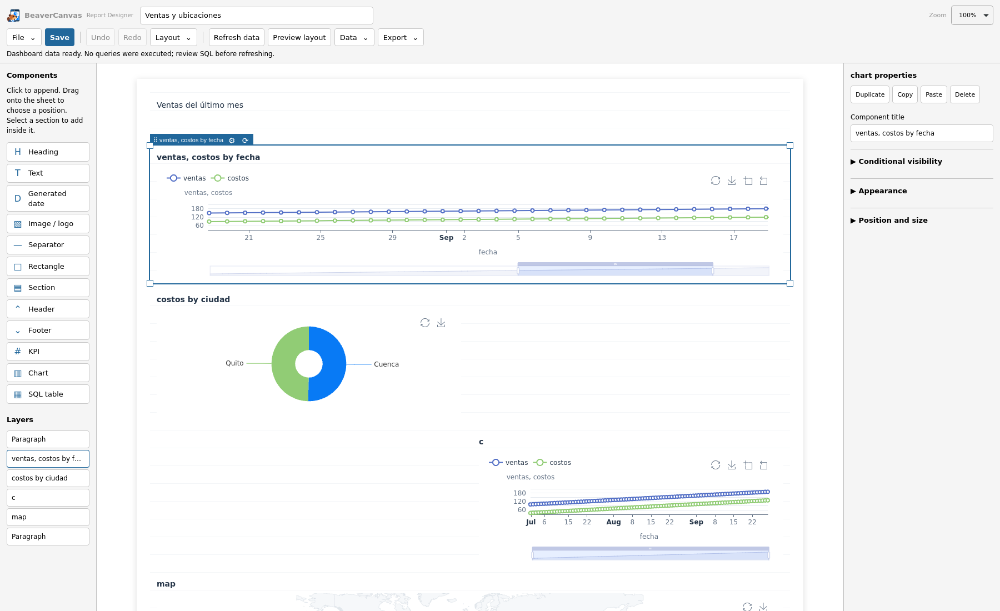
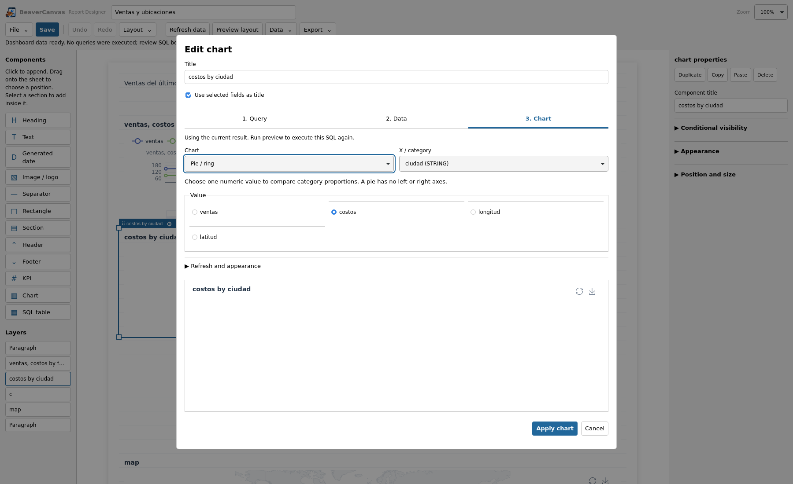

# Edición directa y acciones por gráfico

## Configurar y refrescar

Al seleccionar o pasar sobre un gráfico del reporte aparecen su asa de movimiento,
la **tuerca de configuración** y **actualizar**. La tuerca abre el editor completo
**Query → Data → Chart**, con SQL, conexión, resultados, campos, leyenda y colores.
La lista **Saved query** permite reutilizar las consultas del reporte y su previa.
El panel de propiedades conserva apariencia, posición y condiciones.

Actualizar revisa el SQL de esa fuente y lo ejecuta tras la aprobación habitual.
Los componentes que comparten esa consulta reciben el mismo resultado. Abrir la
configuración, seleccionar una fuente o cambiar el diseño no ejecuta SQL.

## Escribir y mover

- Haz clic en un párrafo o título para escribir directamente. Se guarda texto
  plano, incluidos los saltos de línea; las exportaciones no incluyen controles.
- Haz clic en un espacio vacío de la hoja y empieza a escribir para crear un
  párrafo en esa posición. También puedes hacer doble clic y escribir.
- El panel Content continúa disponible para editar texto y variables de plantilla.
- Arrastra desde el nombre/asa. Los bordes de otros componentes no capturan ese
  gesto. Redimensiona desde el borde o esquina del componente seleccionado.
- Ctrl+Z y Ctrl+Y/Ctrl+Shift+Z conservan el historial del documento. Dentro del
  texto, el navegador conserva su edición local.

## Pastel y vista guardada

El pastel utiliza **un valor numérico**, seleccionado con una opción única; no
presenta ejes izquierdo/derecho. Los valores del tooltip muestran hasta dos
decimales, sin expandir errores de precisión de la suma.

El rango del control de fechas y el zoom/centro del mapa forman parte de la
configuración del gráfico. Se conservan al editar otros componentes, guardar y
reabrir, pasar del dashboard al diseñador, generar la previa y exportar HTML o
correo. Restaurar el gráfico borra esa vista. La vista no modifica el SQL: el HTML
interactivo conserva los datos exportados y permite volver a ajustar el rango.

## Abrir sin consultar una tabla

La barra derecha del workbench incorpora el icono BeaverCanvas. El botón abre un
dashboard nuevo; su menú permite abrir dashboards, Report Designer y reportes
guardados. También hay acceso desde **Window → BeaverCanvas**. La posición exacta
de los elementos vecinos depende de la disposición del workbench.

El dashboard nuevo permite añadir consultas por widget sin crear primero un
resultado SQL. Guardar crea JSON y su SQL compañero; **Save As** permite otra ruta.

## Evidencia

Pruebas de navegador Edge y WebKit: texto directo, hoja vacía, historial,
tuerca/actualización, reutilización de fuentes, pastel, prioridad de movimiento,
vista guardada y HTML sin conexión. Pruebas Java de persistencia eliminan campos
desconocidos del viewport. Pruebas nativas SWT/Edge y SWT/WebKit comprueban el
portapapeles real y el aislamiento frente a un StyledText nativo; el servicio de
comandos del workbench se simula en ese harness. La barra y su handler se verifican
en el registro instalado; no se certifican todas las disposiciones personales.
