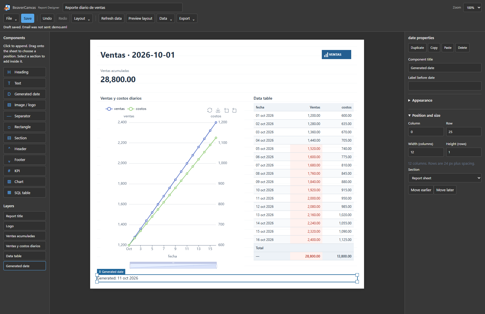
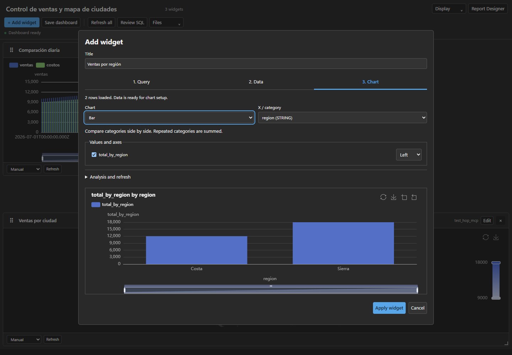
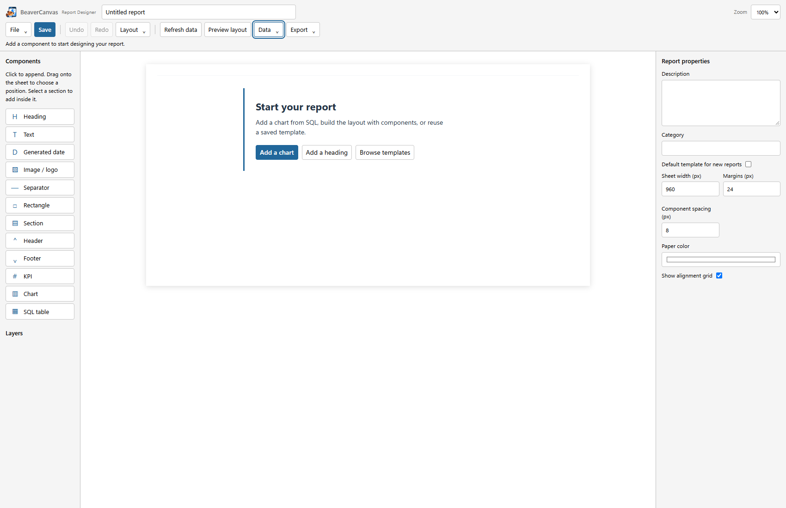

# Interfaz simplificada de BeaverCanvas

Cambios en desarrollo para la próxima versión. Las capturas muestran pruebas del
frontend con datos sintéticos; no corresponden al instalador publicado 0.6.1.

## Report Designer

Guardar, actualizar datos y ver el diseño permanecen a la vista. Archivo agrupa
plantillas, abrir, importar y duplicar; Datos reúne consultas, parámetros y
actualizar con vista previa; Exportar reúne HTML, definición y borrador de correo.
Layout permite cerrar espacios. Deshacer y rehacer conservan sus atajos.

**Preview layout** usa los datos actuales sin ejecutar SQL. **Refresh data** revisa
las consultas antes de actualizar. **Data → Refresh and preview** actualiza los
datos y después abre la vista previa. La apertura de plantillas tampoco ejecuta SQL.

Los menús se pueden abrir con teclado, cerrar con Escape o al hacer clic fuera.
Escape devuelve el foco al control del menú. Sus paneles se mantienen dentro de
ventanas estrechas.

## Crear un gráfico

1. **Query:** elegir conexión, escribir SQL y ejecutar Run preview.
2. **Data:** comprobar las columnas y una muestra de hasta 10 filas y 8 columnas.
3. **Chart:** elegir tipo, categoría, valores y ejes; comprobar la vista previa y aplicar.

Las etapas permiten acceso directo y navegación con flechas, Home y End. Cambiar
de etapa conserva el borrador y no ejecuta consultas. Si ya hay datos al editar,
se abre directamente Chart. Detener la consulta está disponible en cualquier etapa.
Análisis y refresco se despliegan cuando se necesitan.

## Empezar y editar

Un informe vacío ofrece añadir un gráfico, añadir un encabezado o explorar
plantillas. Al seleccionar un componente, el panel muestra primero contenido,
datos y opciones propias de ese componente. Apariencia, posición y visibilidad
condicional son desplegables. Permanecen abiertos mientras se modifica el mismo
componente; al elegir otro, se vuelve al panel simplificado.

Se conserva el azul BeaverCanvas y la tipografía de sistema de la interfaz. Los
colores generales siguen el tema proporcionado por DBeaver; la hoja conserva sus
colores de reporte. Las etiquetas del panel pasan a 12 px y los controles del
diseñador tienen una altura mínima de 32 px.

## Comprobación

Pruebas de navegador en Edge/Windows y WebKit/Ubuntu WSL: creación y edición con
SQL independiente, aprobación y cancelación, navegación con teclado, conservación
del borrador, menús en ventana de 600 px, vista previa sin SQL, guardar/reabrir,
HTML/EML, tablas acotadas, arrastre y tamaño desde los ocho bordes.

Son pruebas funcionales con fixtures y revisión visual de capturas. No sustituyen
una sesión de usabilidad con usuarios nuevos ni certifican el cliente Outlook o
una instalación nativa del nuevo paquete.
